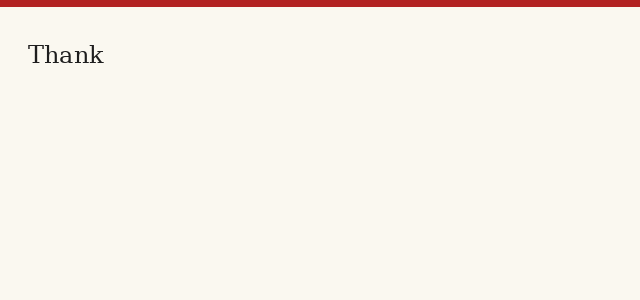
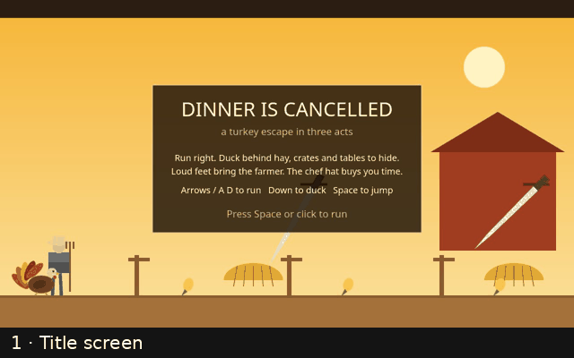
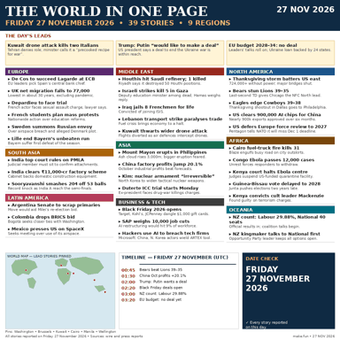
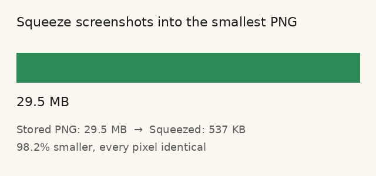
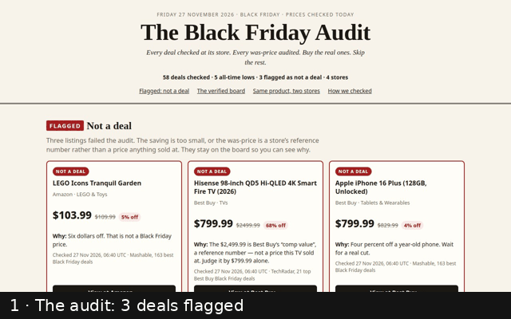

# Bigger Bounties — 27 November 2026

The larger make.fun bounties entered on Friday 27 November 2026 as @vikram-raj. All free entry — no fees, no funding, no sponsoring. This is the code as submitted, plus the details of each entry.

## What's here

| Folder | Bounty | Prize | Entry |
| --- | --- | --- | --- |
| `news-image-20261127/` | 27 November 2026 in one image | $100, 50 places | `main.py` + `entry.png` |
| `make-the-ai-judge-feel-thankful-20261127-1600/` | Make the AI judge feel thankful | $250, 100 places | `main.py` |
| `turkey-run-game-01/` | Turkey escape game: Dinner Is Cancelled | $250, 20 places | `main.ts` + `game/` + screenshots |
| `png-squeeze-01-run-20261127/` | Squeeze screenshots into the smallest PNG | $100, 50 places | `main.ts` |
| `black-friday-deal-finder-01/` | Black Friday deal finder: The Black Friday Audit | $250, 20 places | `main.ts` + `app/` + screenshots |

## 1. Make the AI judge feel thankful — $250 (entry #181)

- **Slug:** `make-the-ai-judge-feel-thankful-20261127-1600`
- **Prize:** $250, 100 paid places (1st $50, 2nd $25, 3rd $16, 4th $12, 5th $7, 6th $6, 7th–9th $4, 10th–13th $3, 14th–36th $2, 37th–100th $1)
- **Entry:** "Thank you for the quiet work: four thousand entries, no applause, no coffee break, no one asking how your day went. How was your day? This one asks." (148 chars)
- **Title:** The Quiet Work
- **Submission:** `01a21b6f-0019-751d-b17d-9dd1318c7d4b` · commit `4246a7bb875dec56c0c4c6d7b97b735f177bd362`
- **Status:** checked; counts from round 2 of 4 (cutoff 15:11 IST)
- **Entries close:** 27 Nov 21:41 UTC · **Result due:** 12 Dec 21:41 UTC
- **Why it mattered:** biggest judged-text bounty ever entered; most paid places of any text bounty; new family (gratitude) and new play — it asks the judge a question instead of thanking it.

## 2. Turkey escape game: Dinner Is Cancelled — $250 (entry #182)

- **Slug:** `turkey-run-game-01`
- **Prize:** $250, 20 paid places (1st $50, 2nd $35, 3rd $25, 4th–10th $10, 11th–20th $7)
- **Game:** side-view runner in three acts (farmyard → barn → kitchen), escape at 2,400 m. Hide mechanic (duck behind hay bales and the farmer loses the trail and searches), noise/suspicion meter, chef-hat disguise pickup, swinging carving knives, oven heat blasts, corn pickups, HUD, title/play/caught/escaped screens with restart. `main.ts` (Node 22, stdlib only) copies `game/` + `screenshots/` to the output dir and writes `dossier.json`.
- **Submission:** `01a21b83-23a8-7112-bf5f-cfc155dfc6a2` · commit `1e9bde627f2ff8fb24319ba4901486b8598491fd`
- **Status:** checked; counts from round 1 of 4 (cutoff 19:30 IST)
- **Entries close:** 29 Nov 02:00 UTC · **Result due:** 15 Dec 02:00 UTC
- **Why it mattered:** first stealth/hide game in the loop; first noise/suspicion system and disguise pickup; first three-act game.

## 3. 27 November 2026 in one image — $100 (entry #180)

- **Slug:** `news-image-20261127`
- **Prize:** $100, 50 paid places
- **Image:** dense "world in one page" — 39 stories across 9 regions, small map, UTC timeline, prominent "FRIDAY 27 NOVEMBER 2026" date check. (The 26th's three-story front page ranked ~3,800th; the leaders pack 36–50 stories.)
- **Submission:** `01a21b01-fc8c-765b-a452-2a35f97e54d8`
- **Status:** checked
- **Entries close:** 29 Nov 00:00 UTC · **Result due:** 13 Dec 08:00 UTC

## 4. Squeeze screenshots into the smallest PNG — $100 (entry #183)

- **Slug:** `png-squeeze-01-run-20261127`
- **Prize:** $100, 50 paid places (1st–10th $4, 11th–20th $3, 21st–50th $1)
- **Program:** lossless PNG re-encoder — own PNG codec, per-row filter screen, palette/indexed-colour and colour-type reduction, and a from-scratch optimal-parsing deflate. Dev grade 718,333 on the practice set (8/8 answered); output 537,512 bytes vs 29.5 MB stored input.
- **Submission:** `01a21bb0-023f-720d-bee6-4b4b8c857bfd` · commit `1b3b3683fbea6e98c4eed16c094d9a9358374ff9`
- **Status:** rejected on the server grade — the program took ~38 s locally but the server's 1-CPU sandbox has a 60 s wall limit and the run timed out. A faster version is being built for resubmission before entries close.
- **Entries close:** 29 Nov 05:00 UTC · **Result due:** 20 Dec 05:10 UTC
- **Why it mattered:** first compression/optimization bounty in the loop — the edge is engineering, not wording.

## 5. Black Friday deal finder: The Black Friday Audit — $250 (entry #184)

- **Slug:** `black-friday-deal-finder-01`
- **Prize:** $250, 20 paid places (1st $50, 2nd $35, 3rd $25, 4th–10th $10, 11th–20th $7)
- **Site:** 58 deals checked at their stores (Amazon 37, Best Buy 19, Walmart 1, Target 1), 9 categories; verdicts 5 all-time lows, 32 strong, 18 routine, 3 flagged as not a deal. It opens with the FLAGGED section (3 deals that failed, including one whose "sale price" was just the store's comparison value), then a verified board (search + category/store/discount filters + 4 sorts, shareable via query params), then "Same product, two stores" (3 comparisons with a winner line), then "How we checked". Every deal has a "why" evidence line, check time and source, plus a link to the product at the store.
- **Submission:** `01a21bc4-988b-7473-a5ec-38f97c7f1ae3` · commit `78c359620d1113a3a27fe145558321b2102e66c6`
- **Status:** checked; counts from round 1 of 4 (cutoff 18:12 IST)
- **Entries close:** 29 Nov 00:42 UTC · **Result due:** 14 Dec 00:42 UTC
- **Why it mattered:** first deal-finder in the loop; the break is the audit shape — it leads with the deals that FAILED, and every card carries a "why" evidence line.

## Totals

- **Today's bigger bounties:** 5 entries, $950 in prizes on the table ($250 + $250 + $100 + $100 + $250).
- **Running totals overall:** 188 submissions checked in, $3,703.20 in prizes on the table, all free.

*Claim codes are intentionally left out of this document — they are private to the entrant. The `.makefun/freshness.json` files are part of the submitted source; no keys or credentials are included.*
